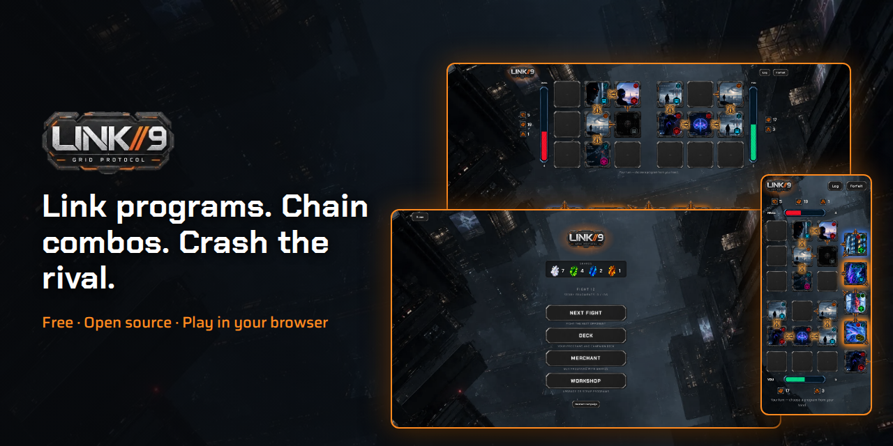
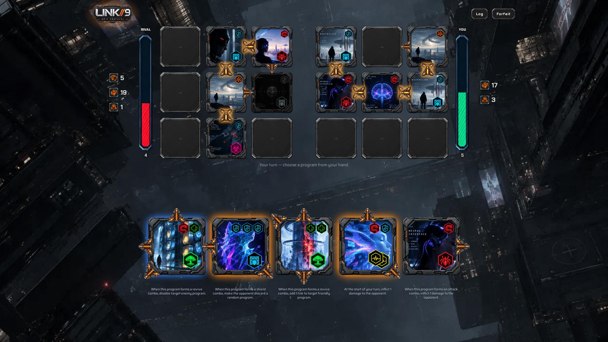
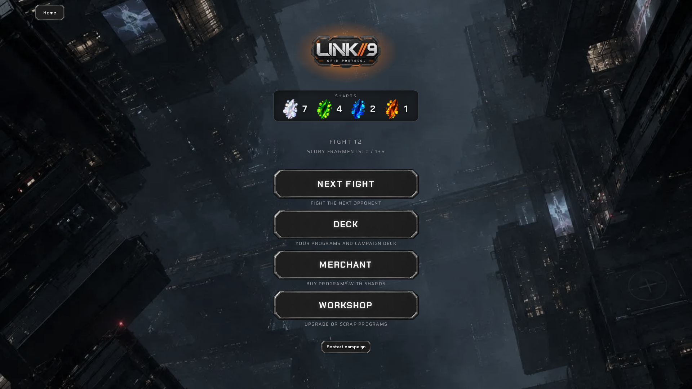
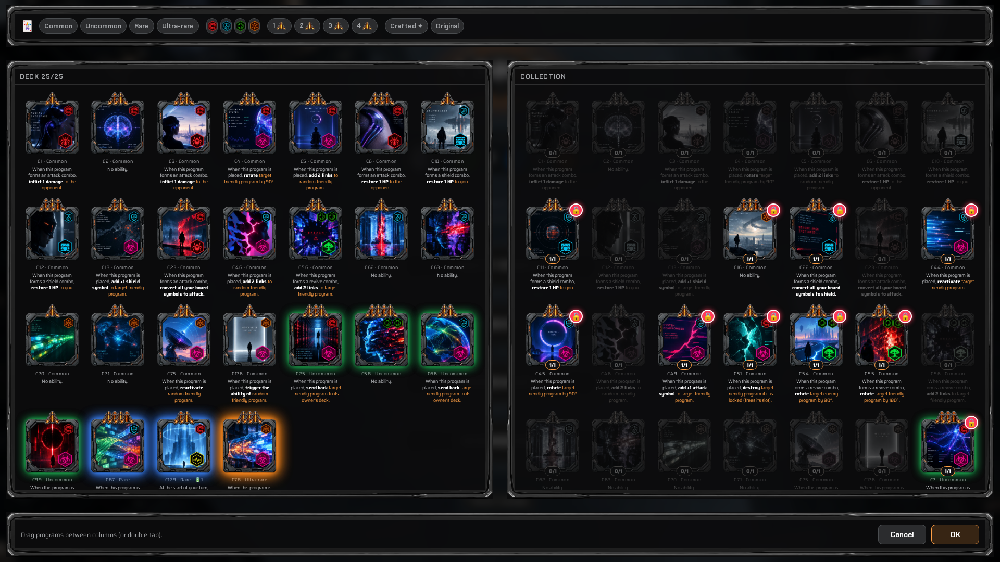
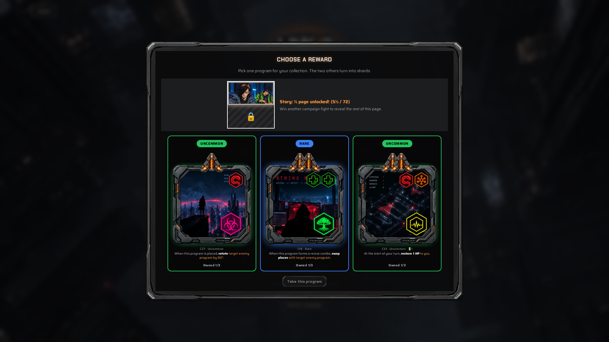
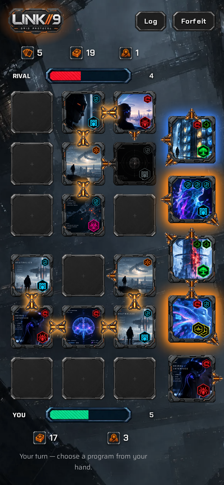
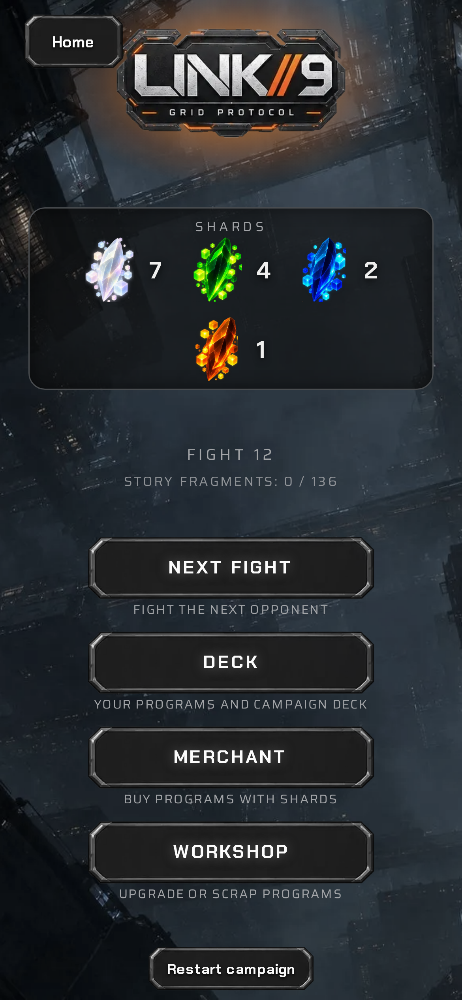
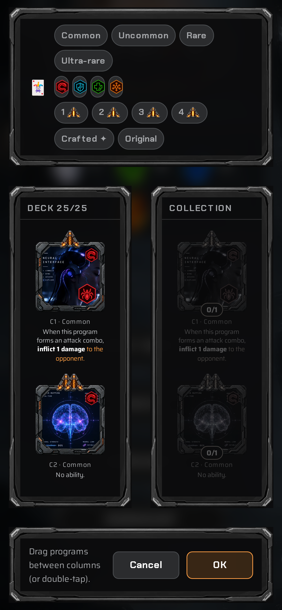
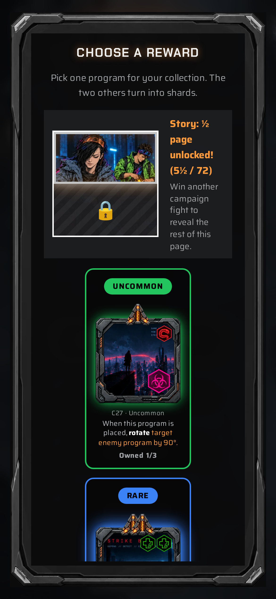

# LINK//9 — Grid Protocol

**A free, source-available, non-commercial cyberpunk-themed card game for your browser.** Hack your way across a 3×3 grid: place programs, link their arrows into chains, trigger combos and crash your rival's hit points before they crash yours.

https://pizzattack.github.io/Link9/

Play online or play locally. No install, no build step, no account, no ads. Works on desktop and phones.

  

## Screenshots

  
  

  
  

  
  
  
  

## Play

- **Online:** [`play from the github pages`](https://pizzattack.github.io/Link9/)
- **Locally:** download the repository and open `index.html` in a recent browser (Chrome, Edge, Firefox, Safari).

## How it plays

Each side has a **3×3 grid**, a **25-program deck** and a hand of **5**. Every turn you place one program on an empty square.

- **Links.** Programs carry arrows on their sides and corners. Two neighbouring programs are *linked* when their arrows face each other. A group of linked programs is a **chain**.
- **Symbols.** Programs carry symbols: **attack**, **shield**, **revive** or **neutral**. When a chain holds **3 symbols or more**, whatever their family, it triggers a **combo**. The most represented family decides the effect: attack hurts the rival, shield heals you, revive wakes your disabled programs. Neutral symbols only help reach 3.
- **Abilities.** Many programs also have an ability: on placement, at the start of your turn, on a combo, or when reactivated. Abilities rotate, lock, destroy, swap, discard, add links or symbols and more.
- **Win** by taking the rival's HP to 0 (you both start at 7, never above 10). **Lose** if your grid is full at the start of your turn.

The in-game **Rules** screen and the guided **Tutorial** cover everything in a few minutes.

## Features

- **180 original programs** in 4 rarities (common, uncommon, rare, ultra-rare), with 20 effect types and 162 illustrations.
- **Random fight:** a quick game against the AI with freshly drawn decks.
- **Campaign:**
  - build a 25-program deck from your collection;
  - win fights to choose 1 of 3 reward programs (the others become **shards**);
  - spend shards at the **Merchant** (random program, pick-1-of-5, shard exchange);
  - improve or scrap programs at the **Workshop**;
  - a **tenacity** reward softens defeats.
- **Illustrated comic:** 72 pages unlocked fragment by fragment as you win campaign fights.
- **Deck editor** with filters by rarity, symbols and links.
- **Guided tutorial** played on the real board.
- **AI opponent** that searches moves with a Monte-Carlo style evaluation, without ever seeing your hand.
- **7 languages:** English, Français, Español, Italiano, Deutsch, 简体中文, 日本語.
- **Sound:** sound effects for every game event and two music playlists (ambient and battle), with volume sliders.
- **Responsive:** layouts for desktop, tablet and phone, with touch drag-and-drop.
- **Installable and offline-ready (PWA):** add it to your home screen and play without a connection once it has loaded. Progress is saved in your browser (localStorage). Nothing is sent anywhere.

## Install it as an app (iPhone, Android, desktop)

- **iPhone / iPad (Safari):** open the game, tap **Share → Add to Home Screen → Add**. It then launches full screen with its own icon. Open it once online and play a few screens so that images and sounds are stored; after that it works offline.
- **Android (Chrome):** menu **⋮ → Install app** (or *Add to Home screen*).
- **Desktop (Chrome / Edge):** click the install icon in the address bar.

Notes: iOS keeps stored data for a limited time if the app is not used for several weeks, and clears it if you clear Safari's website data. Saves live in the browser's storage, so back up anything precious. After an update, close and reopen the app once to get the new version.

- `tools/make-screenshots.mjs` takes the game screenshots (English, desktop + phone) and builds the GitHub social preview and the itch.io cover/banner in one command (see below).
- Scene mode: `index.html?scene=<home|combat|combat-low|campaign|merchant|workshop|deck|reward|rules|tutorial|comic>&lang=<en|fr|…>` shows a reproducible demo state (fixed random seed, no save read or written, sound off). It is what `make-screenshots.mjs` photographs.
- `tools/make-icons.py` regenerates the favicon, the Apple touch icon and the PWA icons from `ui/skin/logo-round.png` (`pip install pillow`, then `python3 tools/make-icons.py` from the repository root).

## About this project

LINK//9 is a personal, non-commercial fan project. I love the gameplay of **Card City Nights** (grid placement, linked arrows, chain combos) but not its art style and lore, and I wanted a fresh set of cards and rules. This is my own take with different rules and content: original programs, a netrunner setting and its own art direction. It is **not affiliated with, endorsed by or derived from** the original game's assets or code. It's not perfect, it was made with AI, so take for what it is : a few hours of fun gameplay provided for free. 

**How it was made**
- **Game design:** direction and curation: a solo human designer on their spare time.
- **Illustrations, comic pages and UI art:** generated with ChatGPT.
- **Code:** written with Claude (Anthropic).

## Credits

- Sound effects and music from [Pixabay](https://pixabay.com/) creators, listed in [CREDITS.md](CREDITS.md).
- Fonts: [Chakra Petch](https://fonts.google.com/specimen/Chakra+Petch) and [Saira](https://fonts.google.com/specimen/Saira), SIL Open Font License 1.1 (licence texts in `fonts/`).

## License

- Source code: [PolyForm Noncommercial 1.0.0](LICENSE) — free for any non-commercial use, no commercial use.
- Illustrations, comic, UI and text: [CC BY-NC 4.0](LICENSE-ASSETS.md), credit **pizzattack**.
- Third-party audio and fonts keep their own licences (see Credits).

The game is free to play and share; selling it or using it commercially is not allowed. Strictly speaking this is “source-available”, not OSI open source.
